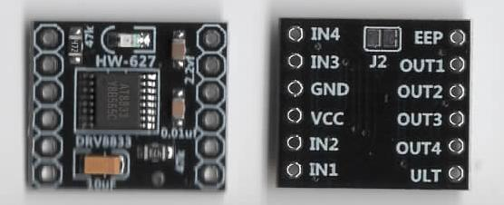
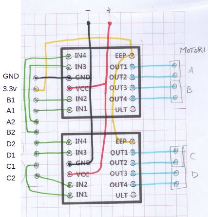
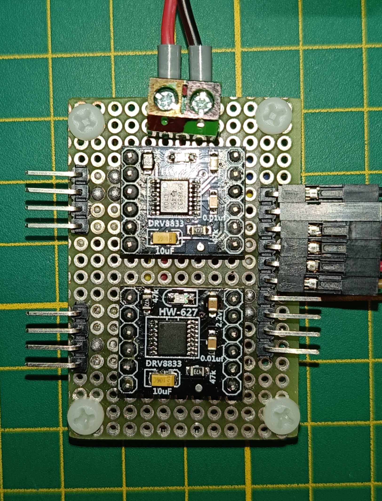

# Motor management

To drive the 4 DC motors rated at 6V, two **DRV8833** modules were used. Both modules receive power directly from the pair of 3.7V batteries (for a total of 7.4V).

## DRV8833 module

https://it.aliexpress.com/item/1005008699175375.html

DRV8833 dual-channel 1.5A 3V-10V DC motor driver module, H-bridge, 4-wire stepper motor control, with overcurrent protection

## Module connections

To activate the module, the "EEP" pin (presumably a mistaken abbreviation for "SLEEP") must be set high.

The two modules share the motor power pins and the enable pin. The figure shows the solder side.

The 4 motors are identified as A, B, C, and D.

## Connection of the board to the microcontroller

The board for motor control connects to the microcontroller through 10 pins, of which:
8 are the 4 pairs of motor control pins, 1 is the enable pin (the voltage for a logic high signal is 3.3V), and 1 is the GND pin.

The commands used to drive the motors are PWM signals whose polarity determines the rotation direction, while the PWM duty cycle controls speed. Therefore, it is necessary to have 8 PWM-capable pins on the microcontroller to manage them.
