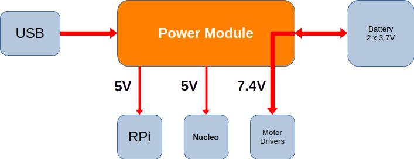
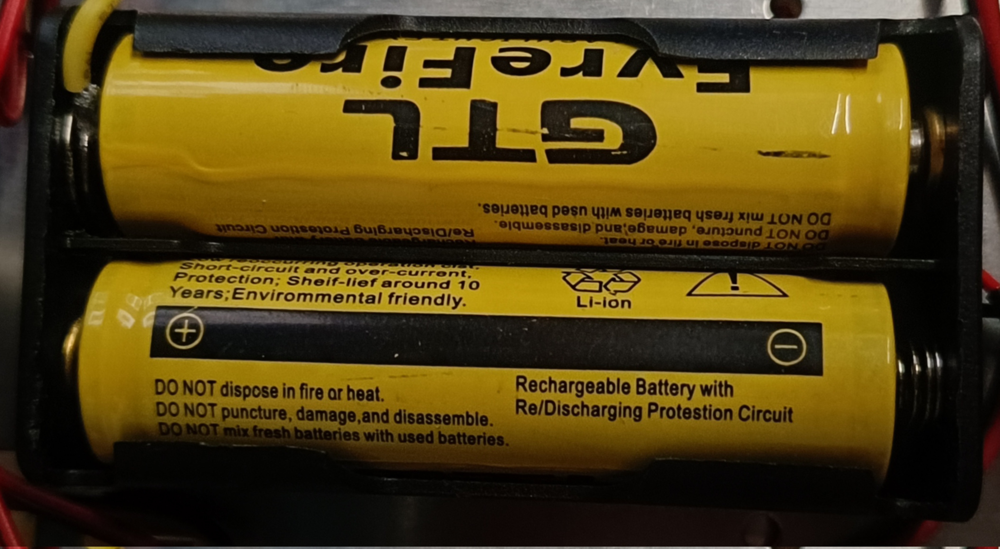
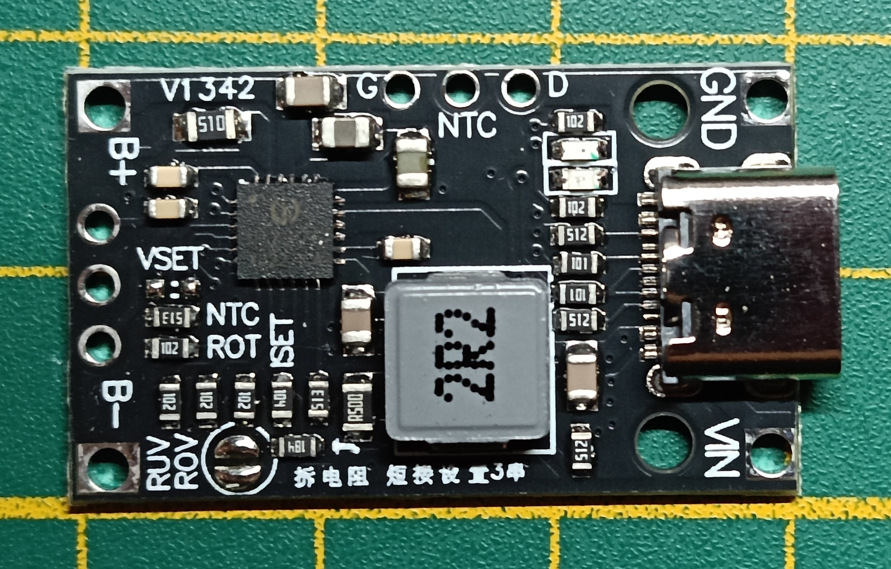
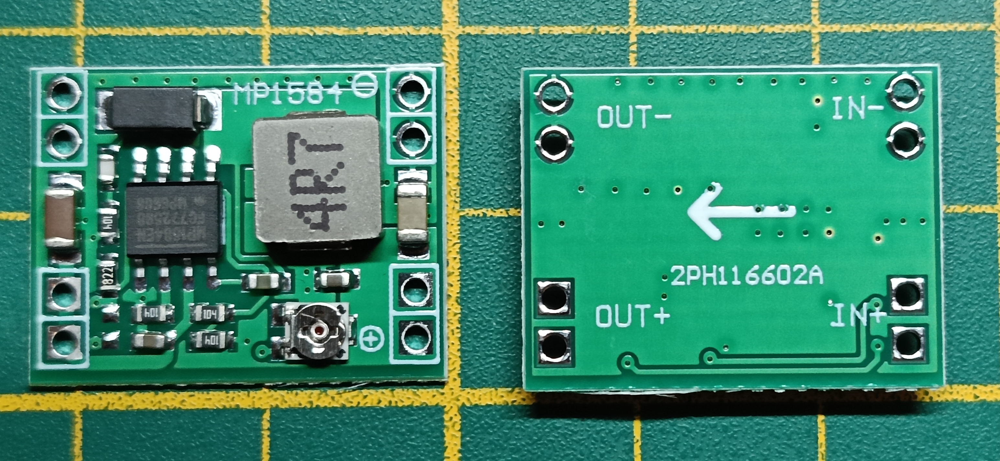
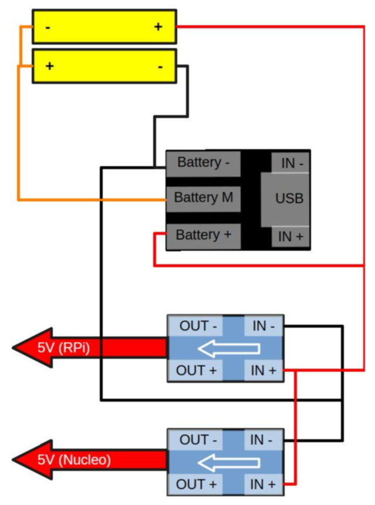

# Power supply and charging

[Italiano](README_it.md)

The power supply module consists of two parts:
- one responsible for charging the battery
- a pair of step-down modules to power the microcontroller and microprocessor boards (two are used to guarantee a 3A peak current per board)

Two rechargeable 3.7V batteries were used as the power source.

## Battery charging module

https://it.aliexpress.com/item/1005012647494433.html

- 2S and 3S lithium battery charging boost module
- Type-C USB BMS 15W 8.4V 12.6V 1.5A max
- support for fast balanced charging
- provision for a charge indicator

## MP1584 Step-Down DC-DC module

- Ultra-compact **MP1584EN** step-down DC-DC power module
- Adjustable **Buck** converter up to **3A**
- Regulated power supply with high precision

## Connections of the two modules and the battery

As a whole, the module has as inputs the two poles of the battery pair (+ and -) plus the center pole (2S balance / Battery_m); as outputs, it has the pairs of 5V connector outputs.

