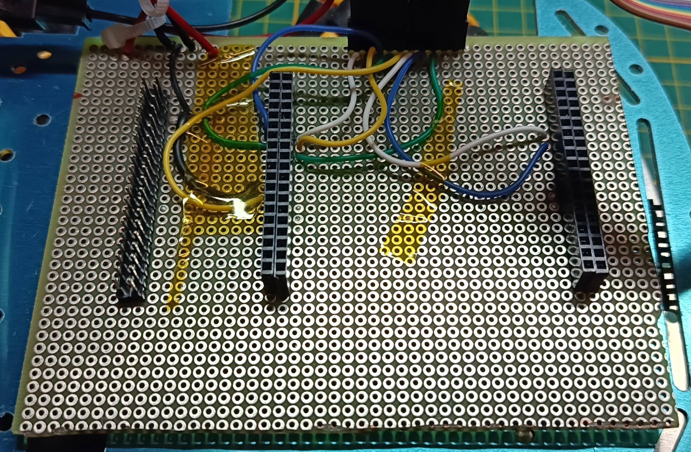
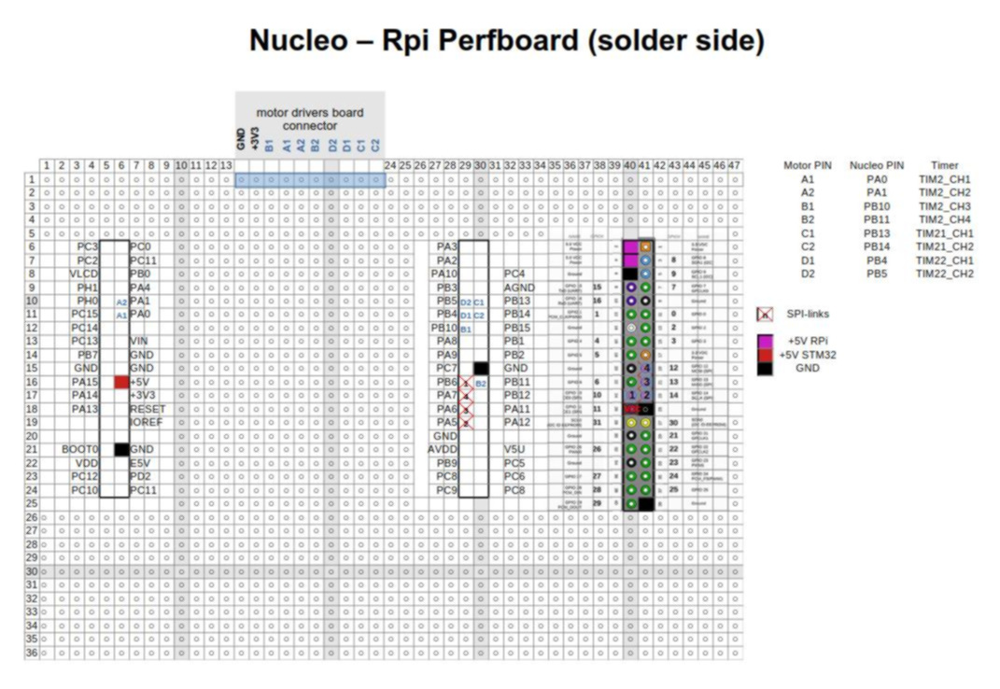
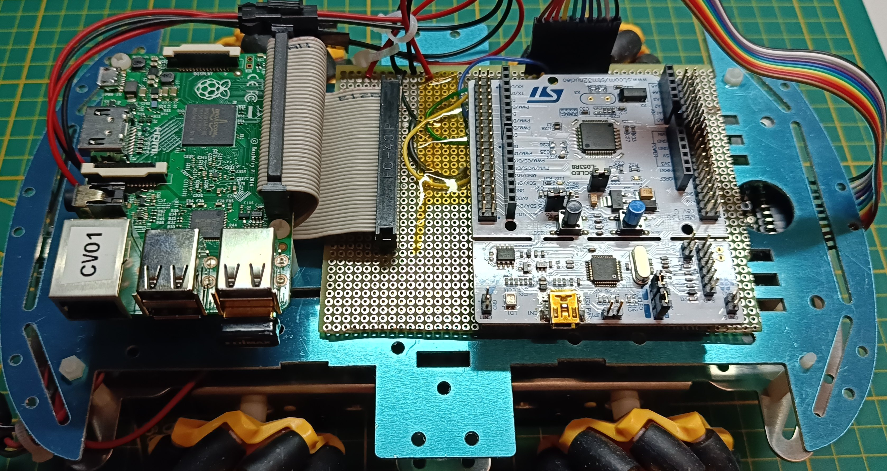

# The board for connecting the STM Nucleo and the Raspberry Pi

To make it easy to connect the STM32 Nucleo microcontroller board to the Raspberry Pi, a perfboard was used with the following components installed:
- a pair of female headers to accommodate the Nucleo pins,
- a male connector to which a flat ribbon cable is attached, connecting it to the Raspberry Pi,
- a pair of connectors for powering the boards,
- a 10-pin male connector for connecting the motor driver board

## Connections on the board

The power connectors are only partially separated (the negative pole is common to both).

The drawing represents the perfboard viewed from the solder side, so it is inverted compared to the usual representation. Unfortunately, I mirrored the Raspberry Pi connector pinout, and the labels are still reversed.

In the diagram, the connections are not shown explicitly, but they can be followed by the labels.

Most of the pins on the boards are free to allow for future expansion.

## Placement of the Nucleo board, the Raspberry Pi connector and external connections

The multicolored flat ribbon cable in the photo is the one that connects the 10 pins of the perfboard to those of the motor driver board.

The following must be connected:
- the two power connectors,
- the Raspberry Pi ribbon cable,
- and the Nucleo is inserted into the prepared sockets.

