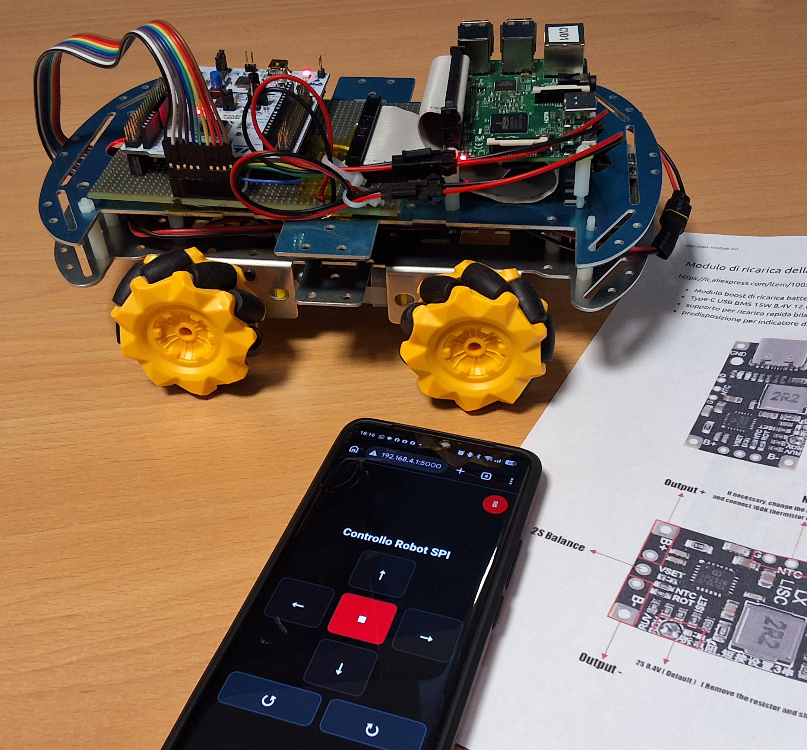

# BotRoby

[Italiano](README_it.md)

BotRoby is an experimental modular mobile robot project for educational use and
experimentation with robotics hardware and software. This repository contains
the Raspberry Pi software, STM32 firmware, and hardware connection
documentation.

The mechanical base is an aluminum chassis with mecanum wheels, available from
various online retailers. The project is under development: before operating
the robot, read the guides and the firmware's known limitations.

## Guides and components

- [Raspberry Pi setup and control](RPi/README.md)
- [STM32 SPI firmware and motor control](arduino/README.md)
- [Power supply and charging](Hardware/Power/README.md)
- [Motor drivers](Hardware/Motor_Drivers/README.md)
- [STM32 Nucleo–Raspberry Pi connection board](Hardware/STM32-RPi_board/README.md)

## Project status

The basic mobility features are still under development. In particular, the
STM32 firmware currently ignores the speed parameter received in the SPI
packet and uses a fixed value. See the limitations section in the
[firmware guide](arduino/README.md).

## Future work

### Electronics

- [ ] Design and build PCBs, taking the chassis mounting holes into account:
  - [ ] Power supply and charging module;
  - [ ] Motor driver module;
  - [ ] Raspberry Pi–Nucleo connection board.
- [ ] Update the connection board schematics with pins for sensors and
  actuators:
  - [ ] Raspberry Pi: LiDAR;
  - [ ] Nucleo: inertial sensors, GPS, servos, limit switches, and other sensors.
- [ ] Connect a speaker, microphone, and camera to the Raspberry Pi.

### Software

- [ ] Add motor speed control.
- [ ] Prepare a Raspberry Pi image with the required scripts and services
  already configured.
- [ ] Play an audible notification when the system is ready.
- [ ] Integrate ROS and Rust.
- [ ] Add unit and regression tests.

### Mechanics

- [ ] Design a camera mount.
- [ ] Design mounts for a microphone and speaker.
- [ ] Design a LiDAR mount.
- [ ] Design general-purpose mounts for sensors and actuators.

## Licenses

The project's software and original materials are covered by separate
licenses. See the [license summary](LICENSES.md) before reusing or
redistributing the content.
