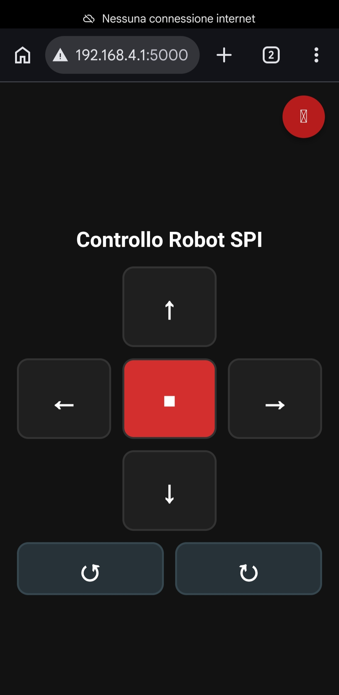

# Software configuration

[Italiano](README_it.md)

The Raspberry Pi handles the higher-level logic and communicates with the STM-Nucleo board through an SPI connection.

A headless version of the operating system was installed (Raspbian Lite).

SSH was enabled for remote access through the Raspberry Pi's text-based configuration interface:

```bash
sudo raspi-config
```

> **Note:** `amministratore` is the username used on this Raspberry Pi. If a different username is chosen, it must be replaced in the code and references below.

## Enabling AP mode on the Raspberry Pi

The Wi-Fi interface must support AP mode so it can be configured to be active at startup and use a known fixed IP address.

The following steps were used:

- Enable AP mode on the `wlan0` interface:
    ```sh
    sudo nmcli device wifi hotspot ifname wlan0 ssid "RaspberryAP" password "12345678"
    ```
- Assign a fixed IP address:
    ```sh
    sudo nmcli connection modify Hotspot ipv4.addresses 192.168.4.1/24
    sudo nmcli connection modify Hotspot ipv4.method shared
    ```
- Assign high priority so the system does not spend time searching for Wi-Fi networks:
    ```sh
    sudo nmcli connection modify Hotspot connection.autoconnect-priority 100
    ```
- To ensure NetworkManager is active at system startup, use:
    ```sh
    sudo systemctl enable NetworkManager
    ```

## SPI web interface for robot control on Raspberry Pi (headless)

This interface is the simplest and most intuitive way to test everything: I connect to the Raspberry Pi Wi-Fi network and open a web page that contains buttons to control the robot by sending SPI commands to the microcontroller.

- **Device**: Raspberry Pi 2 (Raspbian Lite / no desktop)
- **Technology**: Python 3, Flask, spidev, HTML5/CSS3 (Pointer Events)
- **Mode**: Hold-to-move (the robot moves while the button is held, and stops when released)

### 1. SYSTEM PREPARATION

#### A. Enable the SPI interface

The Raspberry Pi SPI interface must be enabled. From the Raspberry Pi terminal, launch the configuration tool:

```bash
sudo raspi-config
```

Then go to `Interfacing Options -> SPI` and select `Enable`. After that, reboot the Raspberry Pi (`sudo reboot`).

#### B. Install the required libraries

Make sure the system has **Python 3**, **Flask**, and the **SPI** module installed:

```bash
sudo apt update
sudo apt install python3-flask python3-spidev
```

## 2. CREATING THE PYTHON SCRIPT ([spi_master_web_SPI.py](spi_master_web_SPI.py))

Using the installed Python libraries, it was possible to create the web control interface: [spi_master_web_SPI.py](spi_master_web_SPI.py). It must be made executable with:

```bash
chmod +x /home/amministratore/spi_master_web_SPI.py
```

### 3. AUTOMATIC STARTUP CONFIGURATION (systemd service)

To ensure that the server starts automatically when the Raspberry Pi powers on:

1. Create the service file:

```bash
sudo nano /etc/systemd/system/robot-web.service
```

2. Paste the following block:

```ini
[Unit]
Description=Robot SPI Web Controller
After=network.target

[Service]
User=amministratore
WorkingDirectory=/home/amministratore
ExecStart=/usr/bin/python3 /home/amministratore/spi_master_web_SPI.py
Restart=always
RestartSec=3

[Install]
WantedBy=multi-user.target
```

Save and exit (`Ctrl + O`, Enter, `Ctrl + X`).

3. Enable and start the service:

```bash
sudo systemctl daemon-reload
sudo systemctl enable robot-web.service
sudo systemctl start robot-web.service
```

### 4. USAGE

Assumption: the Raspberry Pi IP, as configured above, is `192.168.4.1`.

1. Connect to the Raspberry Pi Wi-Fi network.
2. Open the browser and go to:
   `http://192.168.4.1:5000`

<center>

</center>

3. **Control the robot:** the buttons respond to continuous touch (when the finger is released, the robot automatically sends the stop command).

*To check the service status or logs:*

- Status: `sudo systemctl status robot-web.service`
- Real-time logs: `sudo journalctl -u robot-web.service -f`
